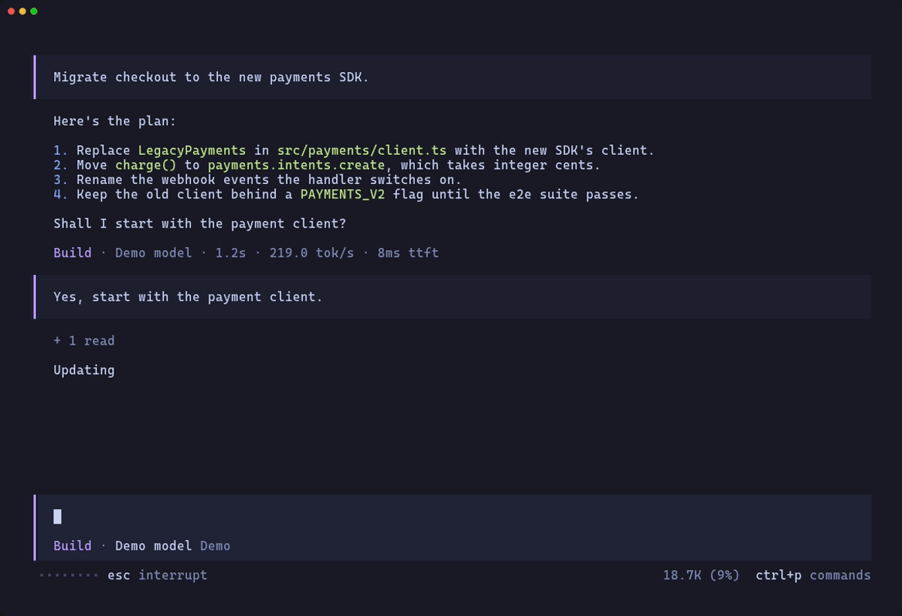
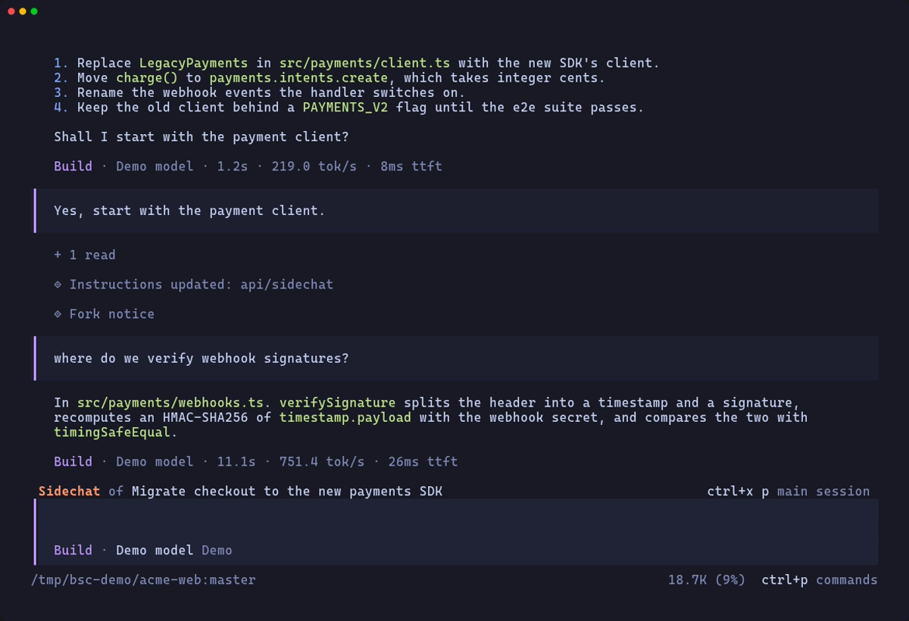
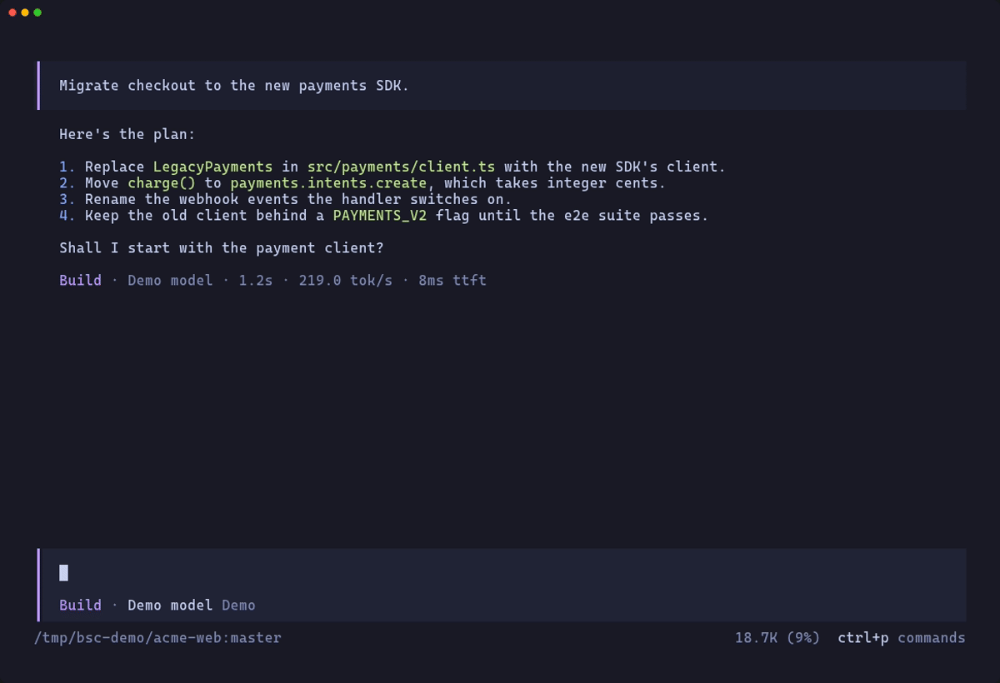
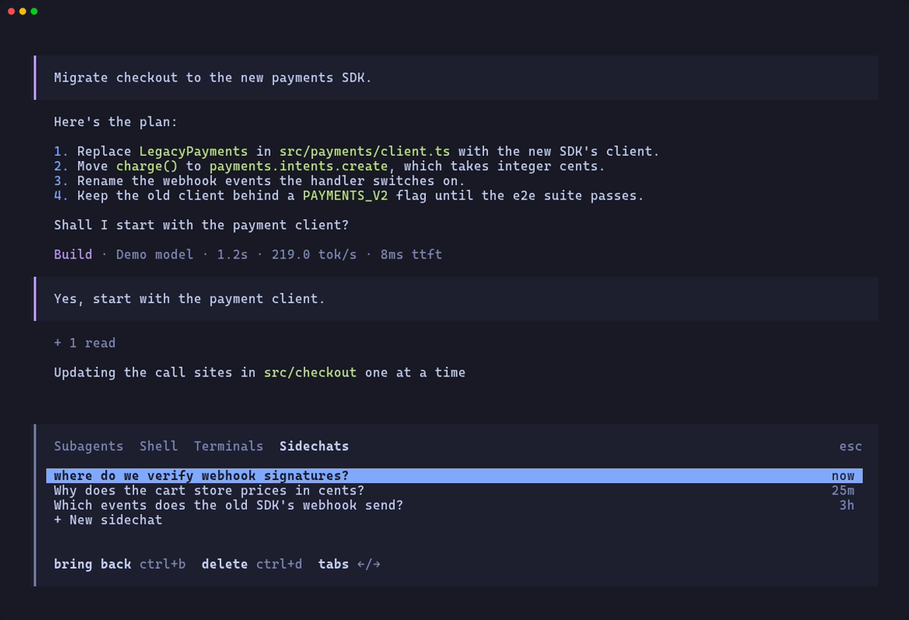
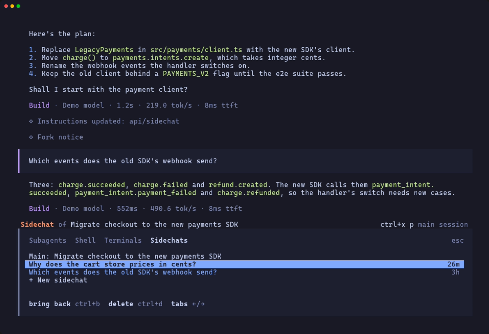
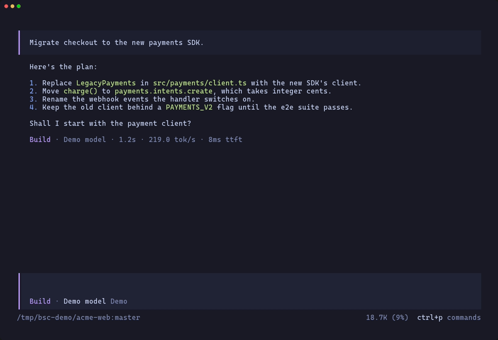
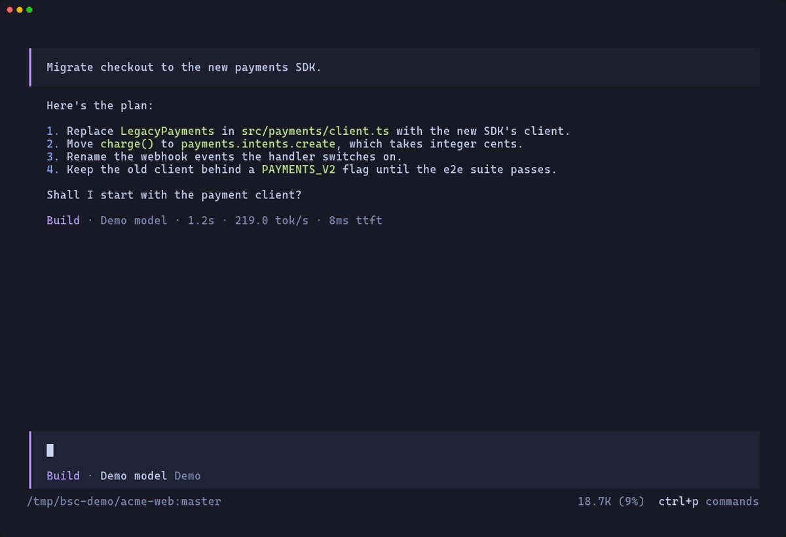
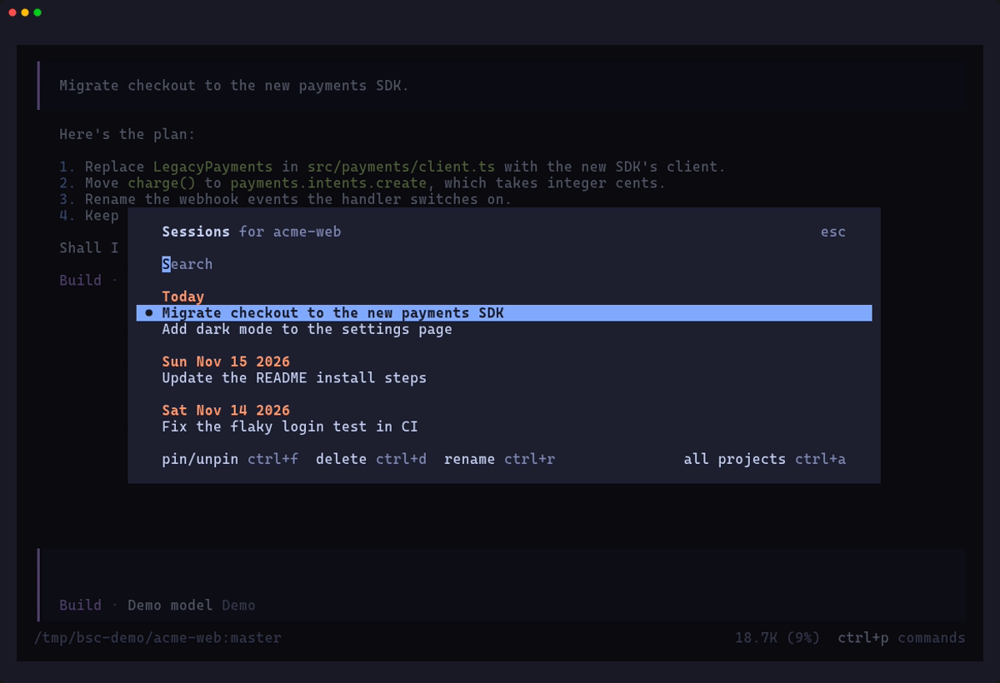
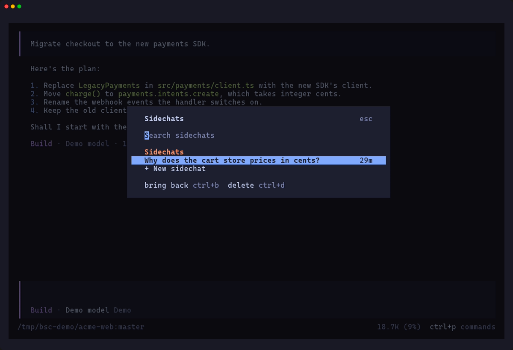

# better-sidechats

Side conversations for the [OpenCode](https://github.com/anomalyco/opencode) TUI, after
[t3code](https://github.com/pingdotgg/t3code)'s side chats. Like `/btw`, a sidechat starts with everything its session
knows, even while that session is still working. Unlike `/btw` it is a real session: you keep asking follow-up
questions, it can use tools and change files, and every edit asks first. Sidechats stay out of the session list; you
find them in a **Sidechats** tab of the composer, the Subagents / Shell / Terminals menu under the prompt.



<sub>The recordings use a sandboxed OpenCode with made-up sessions and a local mock model (see [demo/](demo)).</sub>

## Asking

| Do this                             | What happens                                                                              |
| ----------------------------------- | ----------------------------------------------------------------------------------------- |
| `/btw <question>` (or `/side`)      | Opens a sidechat of this session, asks the question there and shows the answer as it streams |
| `/btw` with no question             | Opens an empty sidechat; its first message names it                                       |
| `down` on an empty prompt, then `←` | The composer, on its last tab: **Sidechats**                                               |
| `<leader>p` in a sidechat           | Back to the main session                                                                  |
| `/sidechats`                        | The same list as a dialog                                                                 |

`/btw` replaces OpenCode's one-shot answer dialog (`replaceBtw: false` keeps it). A sidechat looks and works like any
session. Above its prompt a line says whose sidechat it is; click it or press `<leader>p` to go back.



## The Sidechats tab



| Key                  | In the tab                                                                     |
| -------------------- | ------------------------------------------------------------------------------ |
| `↑` / `↓`            | Move. `↑` on the first row closes the composer, like the other tabs             |
| `return`             | Open the sidechat or the main session; on `+ New sidechat`, open a new one     |
| `ctrl+b`             | Bring the sidechat back to the main session                                    |
| `ctrl+d` (twice)     | Delete the sidechat                                                            |
| `←` / `→`, `esc`     | Other tabs, close (the composer's own keys)                                    |

Rows show `Needs you` (a permission or question is waiting), `Running`, `Brought back`, or how long ago the sidechat
was last active. Inside a sidechat the tab lists its main session first and marks the sidechat you are in.

| In the main session                                                                           | In a sidechat                                                                                         |
| --------------------------------------------------------------------------------------------- | ----------------------------------------------------------------------------------------------------- |
|  |  |

The prompt footer of the main session shows `! 1 sidechat needs you` or `2 sidechats running`, and a toast tells you
when a sidechat you are not looking at asks for a permission or an answer, with a link to open it.

## Edits ask

In a sidechat every edit (edit, write, patch) asks, even when your rules or an earlier "Always allow" allow it.
Configured `deny` rules still deny, and subagents a sidechat starts ask too.



"Always allow" still saves the approval for the project, so it applies to your other sessions, but the sidechat keeps
asking. Add `"shell"` to the server part's `ask` option to be asked before every command too.

## Bring back

Hands the sidechat's own conversation to the main session: your messages, the replies and the files it changed, not
the copied history. It waits in the main session, shows in its transcript as `◈ Sidechat brought back: <title>`, and
reaches the model with your next message there. Available while the main session is idle, as in t3code.


## Out of the session list

Sidechats are archived sessions marked in their metadata. OpenCode's session list, its search, `opencode -c` and
[better-sessions](https://github.com/pedro757/better-sessions) all skip archived sessions; the TUI still opens and
prompts them like any session.



| The session list                                                                              | `/sidechats`                                                                                    |
| --------------------------------------------------------------------------------------------- | ----------------------------------------------------------------------------------------------- |
|  |  |

An empty sidechat you leave without sending anything is deleted, like in t3code. Deleting a main session deletes its
sidechats.

## How sidechats behave

- **Context.** A sidechat is a fork of the session you ask from, made with OpenCode's own fork. Like the built-in
  `/btw` it gets everything settled so far, including the steps a running turn has finished, but not the reply still
  streaming or shell commands still running. It is a snapshot: what the main session does later doesn't reach the
  sidechat's context (the files on disk do change), so ask again with a new `/btw` for a fresh one.
- **Telling the model.** OpenCode's fork notice and a short sidechat note say where it is. Both arrive as messages after
  the copied history, so the system prompt, and with it the provider's prompt cache of that history, stays the same.
- **One level.** `/btw` inside a sidechat forks that sidechat, so the new one knows the side conversation too, but it
  belongs to the same main session. `+ New sidechat` always forks the main session.
- **Model and agent.** A sidechat starts with its session's agent and model; change them in the sidechat as usual.

## Install

```sh
git clone https://github.com/pedro757/better-sidechats ~/.config/opencode/plugins/better-sidechats
```

OpenCode loads both parts from `~/.config/opencode/plugins/` without configuration: the server part (`index.ts`) makes
edits ask, names empty sidechats and deletes the sidechats of deleted sessions; the TUI part (`tui.tsx`) does the rest.
Running TUIs pick it up right away. Disable the TUI part with `"-better-sidechats"` in `plugins` in
`~/.config/opencode/cli.json`.

Built on OpenCode 2.3.0.

## Options

TUI options go in `~/.config/opencode/cli.json`; add an entry only to change them:

```json
{
  "plugins": [
    {
      "package": "./plugins/better-sidechats",
      "options": {
        "label": "Sidechats",
        "composerTab": true,
        "replaceBtw": true,
        "openOnCreate": true,
        "deleteUnused": true,
        "notify": true,
        "keybinds": {
          "parent": "<leader>p",
          "bringBack": "none",
          "tabBringBack": "ctrl+b",
          "tabDelete": "ctrl+d"
        }
      }
    }
  ]
}
```

- `composerTab`: `false` leaves the composer alone; `/sidechats` still lists them.
- `replaceBtw`: `false` keeps the built-in one-shot `/btw` and opens sidechats with `/side` only.
- `openOnCreate`: `false` opens the sidechat in the background; find it in the tab.
- `deleteUnused`: `false` keeps empty sidechats you leave.
- `notify`: toast when a sidechat you are not looking at waits on you.
- `keybinds.parent` and `keybinds.bringBack` are global (`bringBack` has no default key; it is in the command palette as
  "Bring sidechat back"). `tabBringBack` and `tabDelete` work in the Sidechats tab and the `/sidechats` dialog.
  `"none"` turns a key off.

The server part reads `ask` from its entry in `~/.config/opencode/opencode.json(c)`: the permission actions that always
ask in a sidechat. The default is `["edit"]`.

```jsonc
{
  "plugins": [{ "package": "./plugins/better-sidechats", "options": { "ask": ["edit", "shell"] } }],
}
```

Without the server part (for example against a remote server) the TUI adds `ask` rules to the sidechat's session
permissions instead. Those come after the agent's rules, so in the `plan` agent they would ask where plan denies.

## How the tab gets into the composer

OpenCode 2.3.0 has no plugin API for composer tabs: the built-in tabs register through an internal Solid context. The
plugin renders in the `session.composer.top` slot, right above the composer, finds that context by walking Solid's
owner tree from there, and registers a tab like the built-in ones do, so the composer draws its label, switches to it
with `←`/`→` and shows its footer hints. It then moves the tab's list into the composer's box, after the tab labels,
and keeps the tab last when a later tab (Terminals) registers after it. See `src/composer.ts`.

These are OpenCode internals and can change in any release. Every step checks what it finds; if a release breaks it,
the Sidechats tab is missing and everything else, `/sidechats` included, keeps working. A plugin slot for composer tabs
upstream would make this unnecessary.

## Development

`bun test ./test` covers the sidechat marker, the bring-back transcript, the options, and finding and filling the
composer with stand-in owner and renderable trees. The [demo/](demo) folder has the scripts that recorded the media.

Modules that import `solid-js` or `@opentui/*` at runtime are `.tsx`: in OpenCode 2.3.0 a `.ts` module of a local TUI
plugin that imports `solid-js` fails to load with "Cannot find package 'solid-js'" (`src/state.tsx`). Type-only
imports are fine in `.ts` files.

## Credits

- [pingdotgg/t3code](https://github.com/pingdotgg/t3code): side chats, Bring back, and deleting unused and orphaned
  side chats.
- [anomalyco/opencode](https://github.com/anomalyco/opencode): the composer and `/btw` this builds on.
